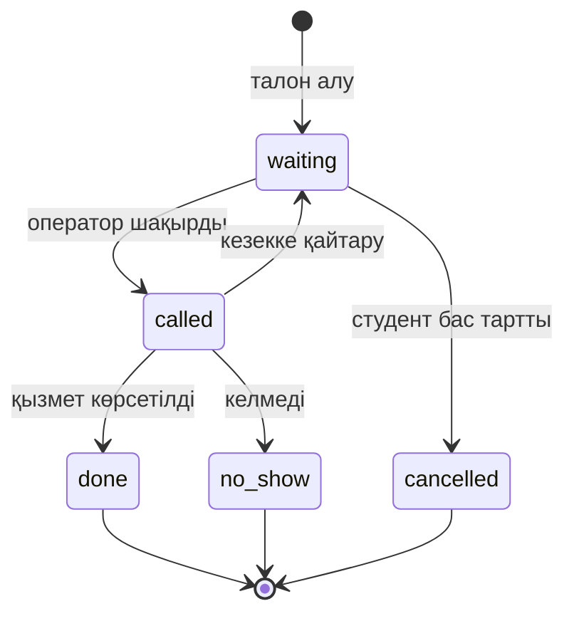
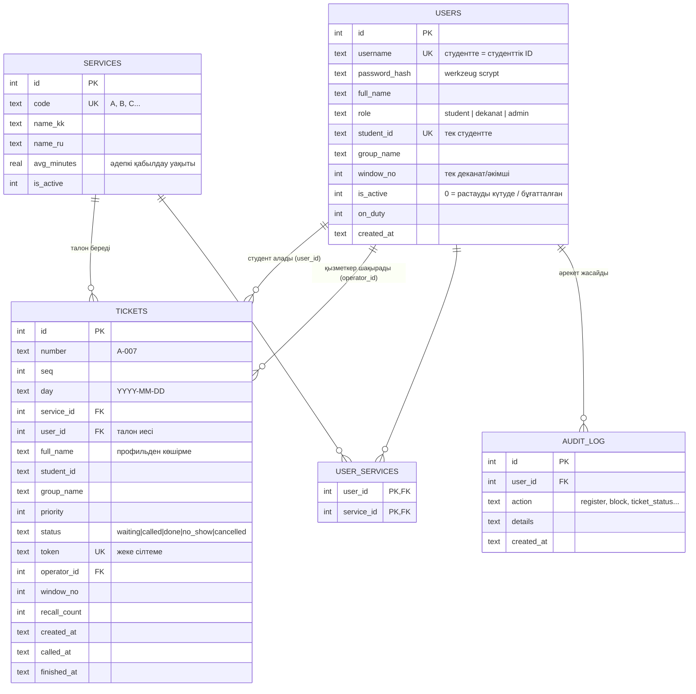

# Техникалық сипаттама
## «Деканатқа арналған электрондық кезек жүйесі»
**Қорқыт Ата атындағы Қызылорда университеті** · 5-нұсқа · Қолданба түрі: Web

---

## 1. Мақсаты
Деканат алдындағы «тірі» кезекті жою, студенттің уақытын үнемдеу және деканат қызметкерлерінің жұмысын ретке келтіру. Жүйенің негізгі мүмкіндіктері: **электрондық талондар**, **күту уақытының болжамы** және **оператор панелі**.

## 2. Пайдаланушылар және олардың мақсаттары

Жүйеде **төрт рөл** бар, олар иерархия бойынша реттелген: **Администратор > Декан > Декан орынбасары > Студент**. Кіру бетінде (`/login`) осы ретпен төрт қойынды тұрады; қойынды тек өріс атауын өзгертеді («ЖСН» не «Логин»).

| Пайдаланушы (рөл) | Тіркелу | Құқықтары мен мақсаттары |
|---|---|---|
| **Администратор** (`admin`) | Аккаунтты тек басқа администратор жасайды немесе растайды | Толық құқық: барлық аккаунттар, кесте, қызметтер, хабарландырулар, талондардағы қателерді түзету, журнал; профильде өз аты-жөнін өзгерте алады |
| **Декан** (`dekanat`) | Өзі өтінім жібереді, оны **тек администратор** растайды | Студенттерді шақырады; администратордан басқа аккаунттарды растайды, бұғаттайды, өзгертеді; кестені, күнтізбені, хабарландыруларды басқарады |
| **Декан орынбасары** (`deputy`) | Аккаунтты администратор не декан жасайды/растайды | Студенттерді қабылдайды; студенттер мен орынбасарлар аккаунттарын басқарады; декан мен администраторға әсер ете алмайды |
| **Студент** (`student`) | Өзі тіркеледі: аты-жөні, ЖСН (бұл логин), топ, құпиясөз. Аккаунт бірден белсенді | Кабинеттен талон алу; қанша күту керегін білу; кезегі келгенде хабар алу; бас тарту; талондар тарихын көру |
| **Табло көрермені** | Кірусіз | Барлық кезекті және қай талон қай терезеге шақырылғанын көру |

Ереже: декан мен орынбасар өзінен жоғары тұрған аккаунтты өзгерте алмайды және өзінен жоғары рөлді бере алмайды (`service.can_manage_user`, `ROLE_RANK`).

## 3. Үш негізгі жұмыс процесі

### 3.1. Тіркелу және талон алу (студент)
```
Студент  →  /register: аты-жөні, студенттік ID, топ, құпиясөз (service.validate_registration)
        →  /login (Студент қойындысы) → /student кабинеті
        →  қызметті таңдайды; аты-жөні мен ID профильден алынады
        →  ережелерді тексереді: жұмыс уақыты, қайталанатын талон, 3 талон лимиті
        →  нөмір береді: A-001 (күн сайын 1-ден басталады)
        →  студент /ticket/<token> бетіне өтеді: алдындағы адам саны + болжам
```

### 3.2. Студентке қызмет көрсету (оператор)
```
Оператор → логин/құпиясөз → панель (on_duty = 1, болжамға терезе ретінде қосылады)
        → «Келесіні шақыру» → жүйе өз қызметтері бойынша басым/ең ерте талонды таңдайды
        → талон күйі: waiting → called; табло мен студент бетінде «Терезе №N» шығады
        → «Аяқталды» (done) | «Келмеді» (no_show) | «Кезекке қайтару» (waiting) | «Қайта шақыру»
```

### 3.3. Әкімшілендіру және қателерді түзету (әкімші)
```
Деканат қызметкері /register?kind=dekanat → аккаунт белсенді емес (is_active = 0)
Әкімші → /admin «Пайдаланушылар» → «Растау» → терезе нөмірі мен қызметтерді тағайындайды
Қате болса (мысалы, оператор «Келмеді» батырмасын қателесіп басса):
       /admin «Талондар» → күйін «Кезекте» немесе «Қызмет көрсетілді» деп түзетеді
       → барлық әрекет audit_log кестесіне жазылады (панельде көрсетілмейді)
```

### 3.4. Кезекті бақылау (табло және студент)
```
/board және /ticket/<token> беттері JSON API-ге әр 4–5 секунд сайын сұрау жібереді
        → шақырылған талондар жасыл түспен ерекшеленіп, дыбыс шығады
        → студенттің телефонында «Сізді шақырды! Терезеге өтіңіз: 2» деген хабар шығады
```

### Талон күйлерінің диаграммасы


## 4. Функционалдық талаптар (тексеру критерийлерімен)

| № | Талап | Тексеру критерийі | Тест |
|---|---|---|---|
| **ФТ-1** | Тіркелген студент кабинеттен талон алады | Қызметті таңдағанда `A-001` форматындағы нөмірі бар талон беті ашылады, ал талон кабинетте көрінеді | `test_student_takes_ticket` |
| **ФТ-1а** | Үш кіру түрі: студент, деканат, әкімші | Әр рөл өз бетіне өтеді (`/student`, `/dekanat`, `/admin`); басқа рөлдің бетіне кіре алмайды; аккаунт басқа қойындыда ашылмайды | `test_login_redirects_to_role_home`, `test_role_access`, `test_wrong_role_tab` |
| **ФТ-1б** | Тіркелу | Студент бірден кіре алады; деканат қызметкері әкімші растағаннан кейін ғана кіреді; әкімші болып тіркелуге болмайды; логин мен ID қайталанбайды | `test_register_student_and_login`, `test_register_staff_pending_until_admin_approves`, `test_cannot_register_as_admin`, `test_register_duplicate` |
| **ФТ-1в** | Әкімші аккаунттарды басқарады | Растау, бұғаттау, рөл, құпиясөз, терезе және қызметтер, өшіру; өзін бұғаттай алмайды; соңғы әкімшіні жоюға болмайды | `test_admin_*`, `test_last_admin_protected` |
| **ФТ-1г** | Әкімші талондардағы қателерді түзетеді | Күйді кез келген соңғы күйге немесе «Кезекте» күйіне ауыстыра алады, талонды өшіре алады; әрекет журналға жазылады | `test_admin_fixes_wrong_status`, `test_admin_fixes_ticket_and_audit` |
| **ФТ-2** | Нөмір қызмет бойынша реттік және күн сайын 1-ден басталады | A-001, A-002, B-001; келесі күні қайтадан A-001 | `test_ticket_numbers_increment_per_service`, `test_numbers_reset_next_day` |
| **ФТ-3** | Форма деректері тексеріледі | Аты-жөні 3–80 әріп, ID 6–12 цифр; қате болса екі тілде хабарлама шығады | `test_validate_errors`, `test_invalid_form_shows_errors` |
| **ФТ-4** | Бір студентке бір қызметке бір белсенді талон, барлығы 3-тен көп емес | Қайталанған сұрауда `err_already_in_queue` / `err_too_many` қатесі шығады | `test_duplicate_active_ticket_rejected`, `test_max_three_active_tickets` |
| **ФТ-5** | Күту уақыты болжанады | `ceil(алдындағылар / ашық терезелер) × орташа уақыт`; орташа уақыт соңғы 20 қабылдаудан есептеледі | `test_estimate_*`, `test_estimate_uses_active_windows` |
| **ФТ-6** | Оператор келесі студентті шақырады | Басымдығы барлар бірінші, қалғаны FIFO бойынша; тек оператордың өз қызметтері; бір уақытта бір студент | `test_pick_next_*`, `test_cannot_call_twice_without_finishing` |
| **ФТ-7** | Оператор қабылдауды аяқтайды / «келмеді» деп белгілейді / кезекке қайтарады | Күй рұқсат етілген өтулер бойынша ғана өзгереді; басқа оператордың талонын өзгертуге болмайды | `test_transitions`, `test_other_operator_cannot_finish_ticket` |
| **ФТ-8** | Студент талоннан бас тарта алады | `waiting` → `cancelled`; бас тартқаннан кейін жаңа талон алуға болады | `test_cancel_ticket` |
| **ФТ-9** | Табло шақырылған талондар мен терезелерді көрсетеді | `/api/board` ішінде нөмір мен терезе бар, жеке деректер жоқ | `test_board_data` |
| **ФТ-10** | Жұмыс уақытынан тыс талон берілмейді | Сенбі, жексенбі, 13:00–14:00 және 18:00-ден кейін `err_closed` қатесі шығады | `test_is_open`, `test_closed_on_weekend` |
| **ФТ-11** | Бүгінгі статистика | Жалпы саны, қызмет көрсетілгендер, келмегендер, орташа күту және қабылдау уақыты | `test_operator_flow_call_done` |
| **ФТ-12** | Көптілді интерфейс (kk / ru) | Ауыстырғыш барлық беттердің тілін өзгертеді; екі тілдегі кілттер жиыны бірдей | `test_language_switch_to_ru`, `test_all_translation_keys_present` |
| **ФТ-13** | Басты бет: жүйе мен университет туралы ақпарат | Бетте 6 бөлім бар (жүйе, университет, тарих, №5 корпус, серіктестер, байланыс), кезектің ағымдағы күйі көрсетіледі, екі тілде жұмыс істейді. Деректер `university_info.py` модулінде, дереккөздері көрсетілген | `test_home_has_university_sections`, `test_home_in_russian`, `test_home_live_queue_counts`, `tests/test_university_info.py` |

## 5. Функционалдық емес талаптар

| № | Талап | Тексеру критерийі |
|---|---|---|
| **ФЕТ-1 Қауіпсіздік** | Құпиясөздер хэштелген, CSRF қорғанысы, SQL-инъекция мен XSS-тен қорғаныс, CSP тақырыбы | `test_passwords_are_hashed`, `test_csrf_protection`, `test_sql_injection_is_harmless`, `test_xss_is_escaped`, `test_security_headers` |
| **ФЕТ-2 Бейімделгіштік** | Интерфейс 360 px (телефон) пен 1920 px (табло) аралығында көлденең айналдырусыз жұмыс істейді | Браузерде 375 px және 1280 px енінде тексерілді (`docs/02_макеттер.md`) |
| **ФЕТ-3 Өнімділік** | Бет 300 мс-тен тез жүктеледі, 1 000 талонда да тез жұмыс істейді | `tickets` кестесінде `(day, service_id, status, created_at)` индексі бар; барлық 205 тест шамамен 1 минутта өтеді (уақыттың көбі scrypt хэштеуіне кетеді) |
| **ФЕТ-4 Сенімділік / тұтастық** | Екі оператор бір талонды ала алмайды, нөмірлер қайталанбайды | `BEGIN IMMEDIATE` транзакциялары және `UNIQUE(day, service_id, seq)` шектеуі; `test_two_operators_get_different_tickets` |
| **ФЕТ-5 Қолжетімділік** | Белгілері (`label`) бар формалар, контраст, басымдық белгісі, дыбыс пен діріл арқылы хабарлау | Барлық `input` өрістерінің `<label for>` белгісі бар |
| **ФЕТ-6 Портативтілік** | Тек Python 3.10+ және Flask қажет; Windows мен Linux-та жұмыс істейді | `README.md` нұсқаулығы, `wsgi.py` (waitress / gunicorn) |

## 6. Деректер моделі

### 6.1. ER-диаграмма
Кестелер саны — 5: `services`, `users` (үш рөл бір кестеде, `role` бағаны), `user_services`, `tickets`, `audit_log`.



### 6.2. Мәтіндік диаграмма (Word-қа көшіру үшін)
```
 ┌──────────────┐ 1      N ┌────────────────────┐ N      1 ┌────────────────┐
 │  services    │──────────│   user_services    │──────────│     users      │
 │──────────────│          │────────────────────│          │────────────────│
 │ id (PK)      │          │ user_id    (FK)    │          │ id (PK)        │
 │ code (UQ)    │          │ service_id (FK)    │          │ username (UQ)  │
 │ name_kk      │          └────────────────────┘          │ password_hash  │
 │ name_ru      │                                          │ full_name      │
 │ avg_minutes  │                                          │ role: student/ │
 │ is_active    │                                          │  dekanat/admin │
 └──────┬───────┘                                          │ student_id(UQ) │
        │ 1                                                │ group_name     │
        │                                                  │ window_no      │
        │ N   ┌────────────────┐  N      1 (user_id)       │ is_active      │
        └─────│    tickets     │───────────────────────────│ on_duty        │
              │────────────────│  N      1 (operator_id)   │ created_at     │
              │ id (PK)        │───────────────────────────└───────┬────────┘
              │ number, seq,day│  UNIQUE(day, service_id, seq)     │ 1
              │ service_id (FK)│                                   │ N
              │ user_id (FK)   │                           ┌───────┴────────┐
              │ full_name      │                           │   audit_log    │
              │ student_id     │                           │ id, user_id(FK)│
              │ group_name     │                           │ action, details│
              │ priority       │                           │ created_at     │
              │ status         │  CHECK(status IN (...))   └────────────────┘
              │ token (UQ)     │
              │ operator_id(FK)│
              │ window_no      │
              │ created_at,    │
              │ called_at,     │
              │ finished_at    │
              └────────────────┘
```

### 6.3. Болжам алгоритмі
1. Соңғы 20 аяқталған қабылдаудың ұзақтығы алынады (`finished_at − called_at`). 0 мен 120 минут аралығынан тыс мәндер есептен шығарылады.
2. Мұндай мәндер 3-тен аз болса, қызметтің әдепкі уақыты (`services.avg_minutes`) қолданылады.
3. Әйтпесе `avg = 0.8 × нақты орташа + 0.2 × әдепкі` формуласы қолданылады. Бұл бір-екі ұзақ қабылдаудың болжамды бұзуына жол бермейді.
4. `күту = ceil(алдындағылар / ашық_терезелер) × avg`. Ешбір терезе ашық болмаса, бір терезе бар деп есептеледі.
5. Болжам жұмыс күнінің соңына сыймаса, студентке ескерту көрсетіледі.

## 7. Архитектура
```
 Браузер (HTML + CSS + app.js)  ──HTTP──▶  app/web.py (Flask маршруттары, CSRF, сессия)
                                              │
                                              ├──▶ app/service.py  (таза бизнес-логика)
                                              ├──▶ app/db.py       (SQLite, транзакциялар)
                                              └──▶ i18n.py         (kk / ru аудармалар)
                                                         │
                                                   instance/queue.db (SQLite)
```

## 8. Қауіпсіздікті басқару (сұрақтарға жауаптар)

**Неліктен бұл технология таңдалды?**
- **Flask** жеңіл, үйренуге оңай және курстағы Python-мен тікелей үйлеседі. Jinja2 шаблондары HTML-ді автоматты түрде экрандайды (XSS-тен қорғаныс). Бір файлда бірнеше бетті жылдам жасауға болады.
- **SQLite** серверді қажет етпейді: бір файл, Python-ға кірістірілген, транзакциялар мен `CHECK` / `UNIQUE` шектеулерін қолдайды. Бір деканат үшін (күніне жүздеген талон) бұл жеткілікті.
- Бизнес-логика бөлек модульде (`app/service.py`) болғандықтан, тесттерді дерекқорсыз да жазуға болады, ал Flask-ты басқа фреймворкке ауыстыру оңай.

**Деректер қалай қорғалады?**
| Қауіп | Қорғаныс |
|---|---|
| Құпиясөздің ұрлануы | `werkzeug.security.generate_password_hash` (scrypt + тұз); ашық құпиясөз сақталмайды |
| SQL-инъекция | Барлық сұрау параметрлі (`?`); `IN (...)` үшін тек `?` белгілері құрастырылады |
| XSS | Jinja2 автоэкрандауы; табло JS-те `textContent` арқылы толтырылады; `Content-Security-Policy: script-src 'self'` |
| CSRF | Әр POST сұрауында `csrf_token` тексеріледі (`secrets.compare_digest`) |
| Сессияны ұрлау | `HttpOnly`, `SameSite=Lax` cookie, HTTPS режимінде `Secure`; кірген кезде сессия жаңартылады |
| Басқа біреудің талонын көру | URL-да ID емес, 128 биттік кездейсоқ `token` бар; API жеке деректерді (аты-жөні, ID) қайтармайды |
| Спам талондар | Бір IP-ден минутына 5 талоннан артық берілмейді; бір студентте 3 белсенді талон лимиті бар |
| Логинді теру арқылы табу | Қате кірістен кейін 0,3 с кідіріс |
| Ашық редирект | `/lang?next=` параметрі тек `/`-пен басталатын ішкі жолдарды қабылдайды |
| Clickjacking | `X-Frame-Options: DENY` |
| Рұқсатсыз әрекет | `role_required(...)` декораторы әр беттің рөлін тексереді; студент басқа біреудің талонынан бас тарта алмайды; талонды тек оны шақырған қызметкер жаба алады |
| Деканат аккаунтын өз бетімен ашу | Өздігінен тіркелген деканат аккаунты `is_active = 0` күйінде болады, оны әкімші растайды; әкімші болып тіркелу мүмкін емес |
| Бұғатталған пайдаланушы | Әр сұрауда `is_active` тексеріледі: бұғатталған пайдаланушының сессиясы бірден жабылады |
| Әкімшінің қателігі | Әкімші өзін бұғаттай не өшіре алмайды; соңғы белсенді әкімшіні жоюға болмайды; барлық әкімші әрекеттері `audit_log` журналына жазылады |
| Әлсіз құпиясөз | Кемінде 8 таңба, әріп пен цифр болуы керек; кіру әрекеттері шектелген (IP бойынша минутына 10) |

**Қандай шеткі жағдайлар тексерілді?** (барлығы `tests/` қалтасында, 205 тест)
- Бос және `None` өрістер, тым қысқа / ұзын аты-жөні, HTML тегтері, 5 және 13 цифрлы ID, әріпті ID, бос орны бар топ атауы
- Күнделікті лимиттің шегі (999 → қате), нөмірлердің жаңа күні 1-ден басталуы
- Жұмыс уақытының шекаралары: 08:59, 09:00, 13:00, 13:59, 14:00, 17:59, 18:00, сенбі, жексенбі
- Нөл адам, нөл терезе, бөлшек минуттар, теріс мәндер, шектен тыс ұзақтықтар
- Рұқсат етілмеген күй өтулері (`done → called`, `waiting → done` және т.б.)
- Басымдығы бар талон, бірдей уақытта алынған екі талон, бос кезек
- Екі оператордың бір мезетте шақыруы, басқа оператордың талонын жабу әрекеті
- Қайталап бас тарту, жоқ токен, 100 таңбалы токен, SQL-инъекция жолдары
- CSRF токенінсіз сұрау, жиі сұрау (rate limit), белгісіз тіл, ашық редирект

**Қолданбаны екінші платформада іске қосу үшін қандай өзгерістер қажет?**
- **Linux серверінде:** код өзгермейді. Тек `gunicorn -w 1 wsgi:app` іске қосылып, алдына nginx (HTTPS) қойылады және `COOKIE_SECURE=1`, `SECRET_KEY`, `QUEUE_DEMO=0` айнымалылары орнатылады.
- **Бірнеше сервер / көп жүктеме:** `app/db.py` модулі PostgreSQL-ге ауыстырылады (`psycopg`, `?` → `%s`, `BEGIN IMMEDIATE` → `SELECT … FOR UPDATE`), ал rate limit Redis-ке көшіріледі. `app/service.py` мен шаблондар өзгермейді.
- **Мобильді қолданба (Android / iOS):** JSON API (`/api/ticket`, `/api/board`) қазірдің өзінде бар. Талон алу мен оператор әрекеттері үшін JSON эндпоинттері мен токенге негізделген аутентификация (JWT) қосылады. Бизнес-логика серверде қалады.
- **Desktop (киоск / терминал):** сайт Electron немесе браузердің киоск режимінде ашылады, талон басып шығару үшін ESC/POS принтері қосылады.

## 9. Қосымша талаптар (2-кезең)

### 9.1. Рөлдер (2-кезең; 4-кезеңде иерархияға ауыстырылды — 2-бөлім мен FR-31-ді қараңыз)
| Рөл | Құқықтары |
|---|---|
| Студент | Тіркелу, талон алу, бас тарту, тарих, профиль |
| Деканат (әдіскер) | Студенттерді шақыру, қабылдауды аяқтау, жеке үзіліс |
| Декан орынбасары | Декан жұмысын атқарады: аккаунттарды растау/бұғаттау, рөл (декандан басқа), құпиясөз, терезе, жұмыс кестесі, қызметтер, талондарды түзету, журнал, студенттерді қабылдау. Декан аккаунттарын өзгерте алмайды және ешкімге «Декан» рөлін бере алмайды |
| Декан | Толық құқық |

Құқық ережесі бір жерде — `service.can_manage_user()`; db.py әр әкімшілік әрекетте оны қайта тексереді (тек интерфейсте жасыру жеткіліксіз).

### 9.2. Функционалдық талаптар

| ID | Талап | Басымдық | Қалай тексеру керек |
|---|---|---|---|
| FR-14 | Декан не орынбасары жұмыс уақытын, түскі үзілісті, 5-ке дейін қысқа үзілісті және жұмыс күндерін орнатады | Жоғары | test_build_schedule_*, test_schedule_tab_and_save |
| FR-15 | Жұмыс уақытынан тыс және кез келген үзілісте талон берілмейді | Жоғары | test_default_breaks_close_reception, test_ticket_refused_during_custom_break |
| FR-16 | Кесте қате болса (басы ≥ соңы, үзіліс жұмыс уақытынан тыс, қабаттасу, 60 минуттан ұзақ) — сақталмайды, қате хабары шығады | Орташа | test_build_schedule_errors (15 жағдай) |
| FR-17 | Қызметкер жеке үзіліске шыға алады: оның терезесіне студент шақырылмайды, табло «үзілісте» деп көрсетеді, болжамға терезе қосылмайды | Жоғары | test_staff_break_blocks_calls_and_windows, test_staff_break_flow |
| FR-18 | Декан орынбасары студенттерді қабылдайды және студент/орынбасар аккаунттарын басқарады, бірақ декан мен администратор аккаунттарына әсер ете алмайды (4-кезеңде нақтыланды, FR-31) | Жоғары | test_deputy_does_dean_work, test_deputy_cannot_touch_dean |
| FR-19 | Көмекші-чат әр бетте бар; талон, жұмыс уақыты, кезек, мекенжай, құжаттар, құпиясөз сұрақтарына қазақ/орыс тілінде жауап береді; түсінбесе, телефон нөмірін ұсынады | Орташа | tests/test_chatbot.py, test_chat_api |
| FR-20 | Жұмыс уақыты мен үзілістер басты бетте, таблода, төменгі бөлікте көрсетіледі | Орташа | test_home_shows_lunch_and_breaks |

### 9.3. Деректер моделіне өзгерістер
- `users.role` — `deputy` мәні қосылды; `users.on_break` — қызметкердің жеке үзілісі.
- Жаңа `settings(key, value)` кестесі: жұмыс кестесі JSON түрінде (`open_at`, `close_at`, `lunch_from`, `lunch_to`, `breaks`, `workdays`).
- Ескі дерекқор іске қосылғанда автоматты түрде жаңартылады (`db._migrate_users`): SQLite CHECK шектеуін өзгертпейтіндіктен, `users` кестесі деректерімен бірге қайта құрылады.

### 9.4. Көмекші-чат туралы шешім
Чат сыртқы AI-сервиссіз, кілт сөздер бойынша жұмыс істейді (`app/chatbot.py`). Себебі: интернетсіз жұмыс істейді, жауаптар болжамды және тесттермен тексеріледі, студенттің сұрағы үшінші тарапқа жіберілмейді. Жұмыс уақыты мен кезек туралы жауаптар дерекқордағы нақты мәліметтерден құрылады.

## 10. Қосымша талаптар (3-кезең: тапсырыс берушінің ескертулері)

### 10.1. Функционалдық талаптар

| ID | Талап | Басымдық | Қалай тексеру керек |
|---|---|---|---|
| FR-21 | Талон жұмыс күндері жұмыс басталардан 15 минут бұрын (08:45) бастап жұмыс аяқталғанға дейін (18:00) беріледі; 18:00-ден кейін студентке «Талон ертең 08:45-ден бастап беріледі» деп көрсетіледі | Жоғары | test_booking_window, test_next_booking_time, test_student_cannot_take_ticket_after_18 |
| FR-22 | Тұрақты мерекелерде (Наурыз, Тәуелсіздік күні т.б.) және декан белгілеген демалыс күндері талон берілмейді; декан қысқартылған күн (мысалы, 09:00–13:00) белгілей алады | Жоғары | test_holiday_and_short_day, test_ticket_refused_on_short_day_afternoon |
| FR-23 | Басты бетте ағымдағы айдың күнтізбесі: өткен күндер — сұр, бүгін — жасыл, алдағы жұмыс күндері — қара (уақытымен), демалыс/мереке — бөлек, қысқартылған күн — қызыл | Орташа | test_month_calendar_states, test_home_calendar_and_service_minutes |
| FR-24 | Декан не орынбасары мерзімі көрсетілген хабарландыру жариялайды; ол барлық беттің жоғарғы жағында көрінеді. Студент хабарландыру жариялай алмайды | Жоғары | test_manager_announcement_and_short_day_on_all_pages, test_student_cannot_post_announcement |
| FR-25 | Студент ЖСН (ИИН) және құпиясөз арқылы тіркеледі және кіреді; ЖСН бақылау цифры ресми алгоритммен тексеріледі | Жоғары | test_iin, test_register_with_iin_and_weak_password |
| FR-26 | Құпиясөз 8–16 таңба; беріктігі көрсетіледі: әлсіз (қызыл), орташа — кіші+бас әріп+цифр (қызғылт сары), жоғары — тыныс белгісі+әріп+цифр (жасыл). Әлсіз құпиясөз қабылданбайды | Жоғары | test_password_strength, test_password_length_limits |
| FR-27 | Профильде аты-жөні, ЖСН/логин, телефон, жынысы, e-mail және профиль суреті (JPG/PNG/WEBP, 2 МБ дейін) | Орташа | test_profile_info_saved, test_avatar_upload_and_access |
| FR-28 | Әр қызметтің бір студентті қабылдаудың болжамды уақыты бар (мысалы, «Өтінішке қол қою» — 1 мин); қызмет тізімінде әріп-кодтар көрсетілмейді | Орташа | test_admin_adds_service, test_home_calendar_and_service_minutes |
| FR-29 | Көмекші-чат кезекке қатысы жоқ сұраққа «деканатқа барғанда маманнан сұраңыз» деп сыпайы жауап береді | Төмен | test_chatbot_polite_fallback |
| FR-30 | Декан құпиясөзін ұмытса, хостинг консолінде `flask --app app.web set-password admin` арқылы жаңасын орнатады (құпиясөз экранда көрінбейді) | Орташа | test_cli_set_password |

### 10.2. Нефункционалдық талаптар
- **NFR-9.** Интерфейс үш негізгі түске құрылған: қою көк (#1b3a6b), алтын (#c9a043), піл сүйегі (#f7f5f0). Күй түстері (жасыл/қызғылт сары/қызыл/сұр) тек мағына беру үшін қолданылады.
- **NFR-10.** Профиль суреті файл атауына емес, мазмұнына (алғашқы байттарына) қарап тексеріледі; суретті тек оның иесі және деканат қызметкерлері көреді; суреттер `instance/avatars` қалтасында сақталып, GitHub-қа түспейді.

### 10.3. Деректер моделіне өзгерістер
- `users`: `phone`, `gender`, `email`, `avatar` бағандары қосылды (ескі дерекқорға `ALTER TABLE` арқылы автоматты түрде). `student_id` бағаны енді студенттің ЖСН-ін сақтайды (бұрын тіркелген аккаунттарда — ескі студенттік ID).
- Жаңа `day_overrides(day PK, kind, open_at, close_at, note, created_by, created_at)` кестесі — ерекше күндер.
- Жаңа `announcements(id, text, start_day, end_day, created_by, created_at)` кестесі — хабарландырулар.
- `services`: «Өтінішке қол қою» (F, 1 мин) қызметі қосылды, әдепкі уақыттар жаңартылды (бір рет, `settings.services_v2` белгісі арқылы).

## 11. Қосымша талаптар (4-кезең: тапсырыс берушінің ескертулері)

| ID | Талап | Басымдық | Қалай тексеру керек |
|---|---|---|---|
| FR-31 | Рөлдер иерархиясы: Администратор > Декан > Декан орынбасары > Студент. Әр рөл өзінен жоғары аккаунтты өзгерте алмайды және өзінен жоғары рөлді бере алмайды; декан өтінімін тек администратор растайды | Жоғары | test_can_manage_user, test_hierarchy_admin_dekan_deputy_student |
| FR-32 | Администратор профилінде аты-жөнін, e-mail, жынысын, телефонын өзгертеді; басқа рөлдерге аты-жөнін өзгерту өрісі көрсетілмейді және сервер оны қабылдамайды | Орташа | test_admin_edits_full_name_others_cannot |
| FR-33 | Таблода кезекте тұрған барлық талондар реті, нөмірі және қызметімен көрсетіледі (шектеусіз), саны жанында жазылады | Жоғары | test_board_shows_whole_queue_in_order |
| FR-34 | Көмекші-чат «Деканат қайда?» сұрағына нақты орнын айтады: №5 оқу корпусы, 2-қабат, оң жақ блоктың ең шеткі кабинеті | Төмен | test_address_and_contacts_use_ctx |
| FR-35 | Басты бетте корпустар кестесі мен «Кіру түрін таңдаңыз» блогы көрсетілмейді; кіру мәзірдегі «Кіру» арқылы | Төмен | test_home_without_role_cards_and_buildings_table |

**Функционалдық емес:** NFR-11 — кодтағы әр функция 30 жолдан аспайды (PEP 8 бойынша «бір функция — бір тапсырма»), `ruff check` ескертусіз өтеді. NFR-12 — `requirements.txt` тәуелділік нұсқаларын бекітеді (`==`).

## 12. Қосымша талаптар (5-кезең)

| ID | Талап | Басымдық | Қалай тексеру керек |
|---|---|---|---|
| FR-36 | Қысқа үзілістер жоқ: кестеде тек жұмыс уақыты мен түскі үзіліс; кесте формасында қысқа үзіліс өрісі жоқ; бұрын сақталған қысқа үзілістер бір рет автоматты түрде өшіріледі | Жоғары | test_default_schedule_has_lunch_but_no_short_breaks, test_schedule_tab_and_save |
| FR-37 | Басқару панелінде «Журнал» қойындысы жоқ; әрекеттер `audit_log` кестесіне жазыла береді | Төмен | test_admin_fixes_ticket_and_audit |
| FR-38 | Басты бетте «80 000 түлек» көрсеткіші мен институттар тізімі көрсетілмейді | Төмен | test_home_shows_lunch_without_short_breaks_and_institutes |

FR-14, FR-16, FR-17-дегі қысқа үзілістерге қатысты бөлік FR-36 бойынша күшін жойды (қызметкердің жеке үзілісі сақталады).
