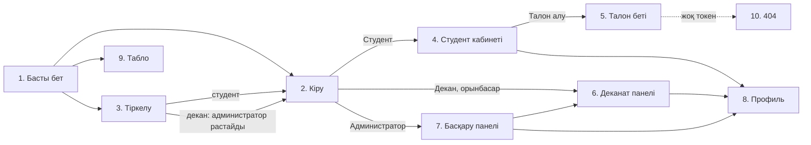

# Экран макеттері
Жүйеде 10 экран бар. Барлығы бейімделгіш: телефонда (≤ 820 px) бағандар бір-бірінің астына түседі. Жоғарғы панельде университет атауы, мәзір (ол рөлге қарай өзгереді), пайдаланушының аты мен рөл белгісі, сондай-ақ **KK | RU** тіл ауыстырғышы тұрады.

> Нақты скриншоттарды алу үшін `flask --app app.web run` командасын іске қосып, беттерді браузерде ашыңыз. Телефон көрінісін көру үшін F12 → Device toolbar (375 px) таңдаңыз.

**Рөлге қарай мәзір:**
| Рөл | Мәзір |
|---|---|
| Кірмеген | Басты бет · Табло · Кіру · [Тіркелу] |
| Студент | Кабинет · Табло · Аты (Студент) · Профиль · Шығу |
| Декан, Декан орынбасары | Деканат панелі · Басқару · Табло · Аты (рөлі) · Профиль · Шығу |
| Администратор | Деканат панелі · Басқару · Табло · Аты (Администратор) · Профиль · Шығу |

---

## Экран 1. Басты бет (`/`)
```
┌──────────────────────────────────────────────────────────────────────────┐
│ [лого] Деканаттың электрондық кезегі   Басты бет Табло Кіру [Тіркелу] KK|RU│
├──────────────────────────────────────────────────────────────────────────┤
│░░░░░░░░░░░░░░░░░░░░░ көк градиентті HERO ░░░░░░░░░░░░░░░░░░░░░░░░░░░░░░░░│
│ (Қорқыт Ата университеті · 1937 жылдан бері)    ┌──── Кезек қазір ● ───┐ │
│ Деканаттың электрондық кезегі                   │ [ 3 ]        [ 2 ]   │ │
│ Бұл — Қорқыт Ата университеті деканатының...    │ адам күтуде  терезе  │ │
│ [Талон алу →] [Тіркелу] [Табло]                 │ A Анықтама  3·≈12мин │ │
│ ● Деканат ашық                                  │ B Өтініш    1·≈6мин  │ │
│                                                 └──────────────────────┘ │
├──────────────────────────────────────────────────────────────────────────┤
│ (Жүйе туралы)(Университет)(Тарихы)(5-корпус)(Серіктестер)(Байланыс) ← жабысқақ мәзір │
├──────────────────────────────────────────────────────────────────────────┤
│ ▌Жүйе қалай жұмыс істейді?                                               │
│ [1 Тіркеліңіз] [2 Қызметті таңдаңыз] [3 Кезекті бақылаңыз] [4 Терезеге]  │
├──────────────────────────────────────────────────────────────────────────┤
│ ▌Қорқыт Ата университеті туралы                                          │
│ Сипаттама мәтіні...                 │ [1937][9 корпус][9000+][115][5][80000]│
│ (институттар тізімі алынды)         │ Рейтингтер: 🏆 QS Asia 2023 ...       │
├──────────────────────────────────────────────────────────────────────────┤
│ ▌Тарихи кезеңдер   ● 1937 … ● 1941–45 … ● 1952 … ● 1998 … ● 2020          │
├──────────────────────────────────────────────────────────────────────────┤
│ ▌№5 оқу корпусы                                                          │
│ ┌ ғимарат суреті ┐ │ 💻 10 компьютерлік сынып                             │
│ │      [5]       │ │ 🖨 №321 «3D printing» зертханасы                     │
│ └────────────────┘ │ 🤖 №316 робототехника зертханасы                    │
│ 📍 Абай даңғ., 66А  │ 🛸 дрон зертханасы   🏗 2023 жылдан қайта жаңарту     │
│ [Картадан ашу ↗]   │                                                       │
├──────────────────────────────────────────────────────────────────────────┤
│ ▌Университет серіктестері — 26 елдің 136 ұйымы                           │
│ ✈ Академиялық ұтқырлық 2025–2026 ...                                     │
│ [SeoulTech][Łódź][HOWEST][Kangnam][Ankara][Osmaniye Korkut Ata]...       │
│ (Ресей 44)(Әзірбайжан 12)(Түркия 12)(Өзбекстан 12)(Қырғызстан 9)...      │
├──────────────────────────────────────────────────────────────────────────┤
│ ▌Байланыс  📍 Бас корпус  ☎ Телефон  🎓 Қабылдау  ✉ E-mail  🌐 Сайт  🕘 │
└──────────────────────────────────────────────────────────────────────────┘
```

## Экран 2. Кіру — төрт қойынды (`/login?role=...`)
```
            ┌──────────── Жүйеге кіру ─────────────┐
            │ Администратор│Декан│Орынбасар│[Студент]│ ← иерархия бойынша
            │ ЖСН             [________________]   │ ← қызметкерлерде: «Логин»
            │ Құпиясөз        [••••••••••••••••]   │
            │ [        КІРУ — СТУДЕНТ          ]   │
            │ Аккаунтыңыз жоқ па? Тіркелу          │
            │ ▸ Демо-аккаунттар                    │
            └──────────────────────────────────────┘
 Қателер: «Логин немесе құпиясөз қате», «Бұл аккаунт басқа кіру түріне тиесілі»,
          «Аккаунт әлі расталмаған немесе бұғатталған».
 Қойынды кіруді шектемейді: аккаунт кез келген қойындыдан ашылады.
```

## Экран 3. Тіркелу (`/register?kind=admin|dekanat|deputy|student`)
```
   Студент қойындысы                          Декан қойындысы
┌──────────── Тіркелу ─────────────┐   ┌──────────── Тіркелу ─────────────┐
│ … | [Студент]                    │   │ … | [Декан] | …                  │
│ Аты-жөні *        [___________]  │   │ ⚠ Декан өтінімін тек             │
│ ЖСН (12 цифр) *   [___________]  │   │   администратор растайды.        │
│   Жүйеге ЖСН арқылы кіресіз.     │   │ Аты-жөні *        [___________]  │
│ Топ *             [___________]  │   │ Логин *           [___________]  │
│ Құпиясөз *        [•••••••••••]  │   │ Құпиясөз *        [•••••••••••]  │
│ Құпиясөзді қайталаңыз * [•••••]  │   │ Құпиясөзді қайталаңыз * [•••••]  │
│ [          ТІРКЕЛУ           ]   │   │ [          ТІРКЕЛУ           ]   │
└──────────────────────────────────┘   └──────────────────────────────────┘
```

## Экран 4. Студент кабинеті (`/student`)
```
┌──────────────────────────────────────────────────────────────────────────┐
│ Студент кабинеті                                                         │
│ Нұрлан Ахметов · Топ ЭК-23-2 · ID 20230077                               │
│ ┌──────────── Талон алу ──────────────┐ ┌──── Белсенді талондарым ─────┐ │
│ │ Қызмет түрі * [B — Өтініш (≈6 мин)▼]│ │ B-001  Кезекте               │ │
│ │ [ ] Мүмкіндігі шектеулі (басым)     │ │ Өтініш  Алдыңызда 0 · ≈0 мин │ │
│ │ [          ТАЛОН АЛУ          ]     │ │               [Ашу] [✕]      │ │
│ └─────────────────────────────────────┘ └──────────────────────────────┘ │
│ ┌──────────────────────── Талондар тарихы ──────────────────────────────┐│
│ │ Күні              │ Талон │ Қызмет          │ Күйі                     ││
│ │ 2026-11-13 10:42  │ A-004 │ Анықтама алу    │ Қызмет көрсетілді        ││
│ └───────────────────────────────────────────────────────────────────────┘│
└──────────────────────────────────────────────────────────────────────────┘
```

## Экран 5. Талон беті (`/ticket/<token>`)
```
┌──────────────────────────────┐        ┌──────────────────────────────┐
│        Сіздің талоныңыз      │        │        Сіздің талоныңыз      │
│           B-001              │        │           B-001              │
│   Қызмет: Өтініш тапсыру     │  ───▶  │ ┌──────────────────────────┐ │
│ ┌────────────┐┌────────────┐ │ шақыру │ │ Сізді шақырды!           │ │ ← жасыл, жыпылықтайды,
│ │Күйі        ││Алдыңызда   │ │        │ │ Терезеге өтіңіз:  2      │ │   дыбыс + діріл
│ │Кезекте     ││2 адам      │ │        │ └──────────────────────────┘ │
│ │Болжам ≈8мин││Алынды 10:42│ │        │  Күйі: Шақырылды             │
│ └────────────┘└────────────┘ │        │                              │
│ [Талоннан бас тарту][Кабинет]│        │ [Кабинет]                    │
└──────────────────────────────┘        └──────────────────────────────┘
```

## Экран 6. Деканат панелі (`/dekanat`)
```
┌──────────────────────────────────────────────────────────────────────────┐
│ Оператор панелі   Декан Ж. Сейітова · Терезе №2                          │
│ Қызметтерім: (A Анықтама) (B Өтініш) (E Транскрипт)                      │
│ ┌────────── Ағымдағы студент ─────────┐ ┌────── Бүгінгі статистика ──────┐│
│ │  B-001                              │ │ 24 барлығы   5 күтуде  17 дайын││
│ │  Нұрлан Ахметов · ЭК-23-2           │ │ 1 келмеді    1 бас тартты      ││
│ │ [Аяқталды][Келмеді][Қайта][Кезекке] │ │ 6.4 орт. күту  4.8 орт. қабылд.││
│ └─────────────────────────────────────┘ └────────────────────────────────┘│
│ ┌──────────────── Күтудегілер (менің қызметтерім) (5) ──────────────────┐│
│ │ A-004 │ Дана Серікқызы │ ЭК-23-2 │ 10:47                              ││
│ └───────────────────────────────────────────────────────────────────────┘│
└──────────────────────────────────────────────────────────────────────────┘
 Студент шақырылмаған кезде [▶ Келесіні шақыру] батырмасы тұрады.
 Терезе немесе қызмет берілмесе: «Әкімшіге хабарласыңыз» деген ескерту шығады.
```

## Экран 7. Басқару панелі (`/admin`)
```
┌──────────────────────────────────────────────────────────────────────────┐
│ Басқару (администратор, декан, орынбасар — иерархия бойынша)             │
│ [24 барлық] [5 күтуде] [17 дайын] [1 келмеді] [6.4 орт. күту] [1 растау] │
│ ┌ Пайдаланушылар ┬ Кесте ┬ Күнтізбе ┬ Қызметтер ┬ Талондар ┐            │
│ Сүзгі: (Барлығы) (Администратор) (Декан) (Орынбасар) (Студент)           │
│ ┌──────────────────────────────────────────────────────────────────────┐ │
│ │ [Декан] Жанар Сейітова  jseitova  ⚠ Белсенді емес            ▾      │ │ ← басқанда ашылады
│ │   [Растау] [Рөл ▼][Рөлді өзгерту] [жаңа құпиясөз][Қалпына келтіру]  │ │
│ │   Терезе [4]  ☑A ☑B ☐C ☐D ☐E  [Сақтау]                 [Өшіру]      │ │
│ │ [Студент] Нұрлан Ахметов  20230077 · ЭК-23-2                        │ │
│ └──────────────────────────────────────────────────────────────────────┘ │
│ ┌───────────── Жаңа аккаунт жасау ─────────────┐                         │
│ │ Рөлі [▼] Аты-жөні [ ] Логин [ ] ID [ ] Топ [ ] Терезе [ ] Құпиясөз [ ] │
│ └──────────────────────────────────────────────┘                         │
└──────────────────────────────────────────────────────────────────────────┘
 «Талондар» қойындысы:  B-001 │ Нұрлан Ахметов │ 12:58 │ — │ [Кезекте ▼][Сақтау] │ [✕]
 «Қызметтер» қойындысы: [A][Анықтама алу][Получение справки][4][☑][Сақтау] … [+ Қосу]
```

## Экран 8. Профиль (`/profile`)
```
┌──────────────────────── Профиль ─────────────────────────────────────────┐
│ (фото) Нұрлан Ахметов · Студент                                          │
│        ЖСН 030512501238 · Топ ЭК-23-2 · Телефон · E-mail · Жынысы        │
│        [Сурет жүктеу] [Суретті өшіру]                                    │
└──────────────────────────────────────────────────────────────────────────┘
┌──────── Жеке деректер ─────────────┐ ┌──────── Құпиясөзді өзгерту ────────┐
│ Аты-жөні [______] ← тек админде    │ │ Қазіргі құпиясөз   [••••••••]      │
│ Телефон  [+7 7__ ___ __ __]        │ │ Жаңа құпиясөз      [••••••••]      │
│ E-mail   [________________]        │ │ ▓▓▓░░ беріктік жолағы              │
│ Жынысы   [Ер / Әйел ▼]             │ │ Құпиясөзді қайталаңыз [••••••••]   │
│ [Сақтау]                           │ │ [Сақтау]                           │
└────────────────────────────────────┘ └────────────────────────────────────┘
```

## Экран 9. Электрондық табло (`/board`)
```
┌──────────────────────────────────────────────────────────────────────────┐
│ Электрондық табло                                                  12:40 │
│ ┌──────────── Шақырылғандар ───────────────┐ ┌ Кезекте тұрғандар (5) ──┐ │
│ │  Талон               Терезе              │ │ № Талон  Қызмет         │ │
│ │ ███ B-001 ██████████ 2 ████████████████  │ │ 1 A-004  Анықтама алу   │ │
│ │     A-002            1                   │ │ 2 B-002  Өтініш тапсыру │ │
│ └──────────────────────────────────────────┘ └─────────────────────────┘ │
└──────────────────────────────────────────────────────────────────────────┘
 Табло тек нөмір, терезе және қызметті көрсетеді (жеке деректер жоқ); кезек толық, шектеусіз.
```

## Экран 10. Қате беті (404)
```
            ┌───────────────────────────────────┐
            │        Бет табылмады              │
            │        [ Басты бет ]              │
            └───────────────────────────────────┘
```

## Экрандар арасындағы өтулер


---

## 2-кезеңдегі өзгерістер

**Жалпы безендіру.** Беттің жоғарғы жағында қою көк жолақ (жұмыс уақыты, телефон, KK | RU), астында ақ тақырып (логотип, атауы), одан кейін көк мәзір. Мазмұн жұқа шекаралы ақ блоктарда, деректер кәдімгі кестелерде. Төменгі бөлікте университет, байланыс және жұмыс уақыты. Басты беттен рейтингтер мен «елдер бойынша» белгілері алынып тасталды.

### Басқару → Жұмыс кестесі
```
┌───────────────────────── Жұмыс кестесі ─────────────────────────┐
│ Талондар тек жұмыс уақытында және үзілістен тыс беріледі...     │
│ Жұмыс басталады [09:00]        Жұмыс аяқталады [18:00]          │
│ Түскі үзіліс басы [13:00]      Түскі үзіліс соңы [14:00]        │
│ Жұмыс күндері ☑Дс ☑Сс ☑Ср ☑Бс ☑Жм ☐Сб ☐Жс                       │
│ [Сақтау]                                                        │
└─────────────────────────────────────────────────────────────────┘
```

### Деканат панелі — үзіліс
```
 Қазір: ашық, қабылдау жүріп жатыр                     [Үзіліске шығу]
 ── үзілісте ──
 Сіз үзілістесіз. Студенттер сіздің терезеңізге шақырылмайды. [Жұмысқа оралу]
 [Келесіні шақыру] — белсенді емес
```

### Табло — терезелер
```
┌── Терезелер ───────────────┐
│ Терезе 2        қабылдауда │
│ Терезе 3          үзілісте │
│ Дс–Жм 09:00–18:00, түскі   │
│ үзіліс 13:00–14:00 ...     │
│ [QR] Телефоннан ашу        │
└────────────────────────────┘
```

### Көмекші-чат (әр бетте)
```
                                   ┌──── Көмекші ───────── × ┐
                                   │ Сәлеметсіз бе! Талон,   │
                                   │ жұмыс уақыты немесе ... │
                                   │      Жұмыс уақыты қандай?│
                                   │ Деканат жұмыс уақыты:   │
                                   │ Дс–Жм, 09:00–18:00 ...  │
                                   │ [Талонды қалай алуға...]│
                                   │ [Сұрағыңызды жазыңыз][>]│
 [Сұрақ қою]                       └─────────────────────────┘
```

---

## 4-кезеңдегі өзгерістер
- **Логотип** — университеттің «UK» белгісі (шапкада және браузер қойындысында).
- **Басты бет** — «Кіру түрін таңдаңыз» карточкалары мен корпустар кестесі алынып тасталды; кіру мәзірдегі «Кіру» арқылы.
- **Кіру / тіркелу** — қойындылар иерархия бойынша: Администратор, Декан, Декан орынбасары, Студент.
- **Табло** — «Кезекте тұрғандар» кестесі: барлық күтіп тұрған талондар (№, талон, қызмет), жанында жалпы саны; бірінші тұрған жол ерекшеленеді.
- **Профиль** — администраторда «Аты-жөні» өрісі бар (Экран 8).
- **Телефондар** — деканат және қабылдау комиссиясы: 8 777 777 77 77.
- **5-кезең:** басты беттен «80 000 түлек» көрсеткіші мен институттар тізімі алынды; қысқа үзілістер жойылды (кестеде тек жұмыс уақыты мен түскі үзіліс); басқару панелінен «Журнал» қойындысы алынды.
