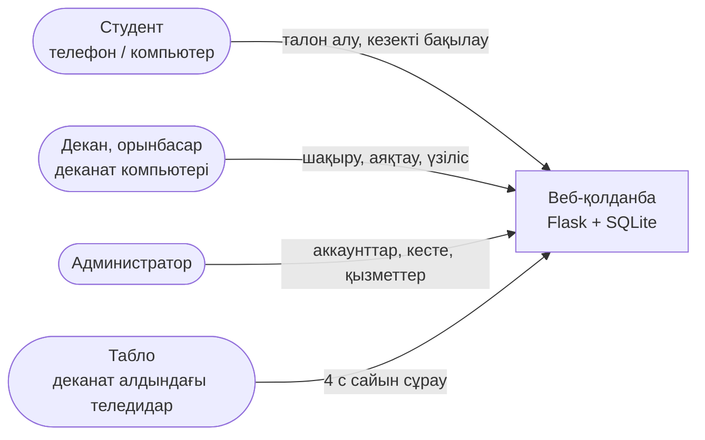
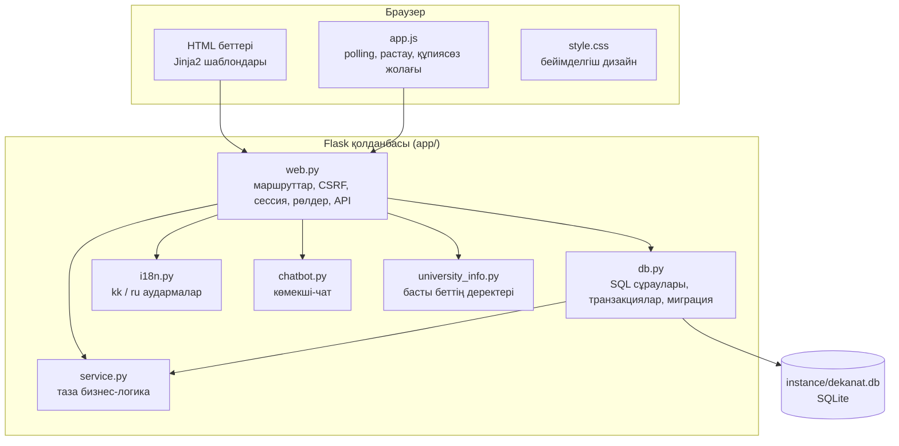
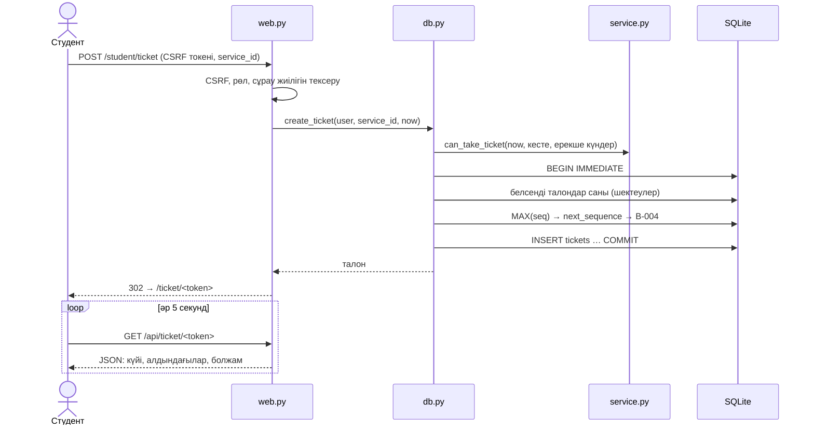
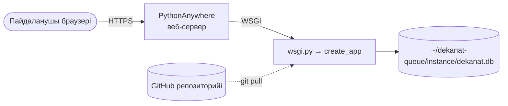

# Архитектура сипаттамасы
**Деканаттың электрондық кезегі** · ISO/IEC/IEEE 42010 идеялары бойынша: жүйе бірнеше көзқараспен (контекст, құрылым, деректер, орналастыру) сипатталады.

## 1. Жүйенің мақсаты мен контексті

Жүйе деканатқа келетін студенттердің кезегін электрондық түрде жүргізеді: студент талонды онлайн алады, деканат қызметкері келесі студентті бір батырмамен шақырады, табло мен студенттің телефоны бірден жаңарады.

**Сыртқы жүйелер жоқ:** SMS, электрондық пошта не университеттің басқа жүйелерімен байланыс қолданылмайды. Барлық деректер бір SQLite файлында сақталады.

## 2. Компоненттер (құрылымдық көзқарас)

Үш қабатты схема: **интерфейс — бизнес-логика — сақтау орны**. Логика интерфейстен бөлек, сондықтан оны веб-сайтсыз тестілеуге және кейін жұмыс үстелі не мобильді интерфейске қосуға болады.

| Модуль | Жауапкершілігі | Тәуелділігі |
|---|---|---|
| `app/service.py` | Талон нөмірі, күту болжамы, келесі студентті таңдау, жұмыс кестесі мен үзілістер, мерекелер мен күнтізбе, ЖСН бақылау цифры, құпиясөз беріктігі, рөлдер иерархиясы (`can_manage_user`) | Тек Python стандартты кітапханасы — Flask-сыз да жұмыс істейді |
| `app/db.py` | Кестелер, миграция, барлық SQL (тек `?` параметрлерімен), транзакциялар (`BEGIN IMMEDIATE`), журнал | `sqlite3`, `service.py`, `werkzeug.security` |
| `app/web.py` | HTTP маршруттары, CSRF, сессия, рөлдерді тексеру, қауіпсіздік тақырыптары (CSP), JSON API, CLI командасы | Flask, `db.py`, `service.py`, `i18n.py`, `chatbot.py` |
| `app/i18n.py` | Қазақша және орысша мәтіндер, `t()` функциясы | — |
| `app/chatbot.py` | Сұрақтың ниетін кілт сөздер бойынша анықтап, жауап құрады | — |
| `app/templates/`, `app/static/` | Беттер, стиль, клиенттік скрипт (CSP бойынша inline-скрипт жоқ) | — |

**Маршруттарды тіркеу.** `web.py` маршруттарды шағын топтарға бөледі (`_register_login_routes`, `_register_board_routes` …); олардың тізімі `ROUTE_GROUPS` кортежінде, ал `create_app()` оларды ретімен тіркейді. Әр функция 30 жолдан аспайды.

## 3. Негізгі сценарий: талон алу (динамикалық көзқарас)

## 4. Деректер көзқарасы

Дерекқор — 8 кесте. Толық ER-диаграмма `docs/01_техникалық_сипаттама.md`, 6.1-бөлімінде.

| Кесте | Мазмұны | Негізгі кілттер мен шектеулер |
|---|---|---|
| `users` | Аккаунттар: рөл, ЖСН/логин, құпиясөз хэші, терезе, профиль | `role CHECK IN ('student','dekanat','deputy','admin')`, `username UNIQUE` |
| `services` | Қызметтер және бір студентті қабылдау уақыты | `code UNIQUE`, `avg_minutes > 0` |
| `user_services` | Қызметкер қандай қызметтерді көрсетеді (көп-көпке) | `(user_id, service_id)`, FK |
| `tickets` | Талондар: нөмір, күн, күй, терезе, уақыттар, жеке токен | `status CHECK`, `token UNIQUE`, FK → users, services |
| `settings` | Жұмыс кестесі (JSON), бір реттік миграция белгілері | `key` PK |
| `day_overrides` | Мерекелер мен қысқартылған күндер | `day` PK |
| `announcements` | Хабарландырулар және көрсету мерзімі | мерзімі: басталу ≤ аяқталу |
| `audit_log` | Кім, не, қашан өзгертті | FK → users |

**Күн мен уақыт** `ЖЖЖЖ-АА-КК СС:ММ:сс` мәтіні түрінде сақталады: мұндай жолдар уақыт ретімен салыстырылады, сондықтан SQL-де тікелей сұрыптауға болады.

## 5. Негізгі шешімдер

| Шешім | Баламалар | Неге осы таңдалды |
|---|---|---|
| **Flask** | Django, FastAPI | Нұсқа бойынша ұсынылған; жеңіл, түсінікті; HTML беттерге Jinja2 бар. Django бұл көлемге артық, FastAPI негізінен JSON API үшін |
| **SQLite** | PostgreSQL, MySQL | Сервер керек емес, бір файл, транзакциялар мен CHECK шектеулері бар. Бір деканатқа (күніне жүздеген талон) жеткілікті. Шектеуі: бір уақытта бір процесс жазады — көп жүктемеде PostgreSQL-ге көшу керек |
| **Беттер серверде құрылады** (Jinja2) | React/Vue SPA | Қарапайым, JavaScript-сіз де жұмыс істейді, CSP-ді қатаң ұстауға болады |
| **Polling** (4–5 с сайын JSON) | WebSocket | Тегін хостингте WebSocket қолжетімсіз; кезек үшін 4 секундтық кідіріс маңызды емес |
| **Өз CSRF тексеруі** (сессиядағы токен) | Flask-WTF | Бір тәуелділік аз; формалар қарапайым. Токен әр POST сұрауда және `X-CSRF-Token` тақырыбында тексеріледі |
| **`BEGIN IMMEDIATE`** транзакциясы | Тексеру мен жазу бөлек | Екі студент бір уақытта талон алса не екі қызметкер бір студентті шақырса, нөмір қайталанбайды |
| **Әр сұрауға жеке SQLite қосылымы** | Бір ортақ қосылым | Ағындар бір қосылымды бөліссе, сұраулар бір-біріне кедергі жасап, қате шығатын (тестілеуде табылды) |
| **Жергілікті уақыт** `Asia/Qyzylorda` (`zoneinfo`) | Сервер уақыты | Хостинг UTC уақытымен жұмыс істейді, ал деканат Қызылорда уақытымен |

**Шеткі жағдай мысалы — уақыт аралықтары.** Түскі үзіліс `[басы, соңы)` жартылай ашық аралық ретінде тексеріледі: 13:00–14:00 болса, 14:00-де қабылдау қайта ашылады. Бұл `test_default_schedule_has_lunch_but_no_short_breaks` тестімен расталады.

## 6. Орналастыру көзқарасы

- Хостинг: **PythonAnywhere** (тегін тариф), виртуалды орта `.venv`, WSGI файлы `create_app()` шақырады; `QUEUE_DEMO=0`, `SHOW_DEMO_ACCOUNTS=0`.
- Құпия кілт: `SECRET_KEY` орта айнымалысынан, болмаса `instance/secret_key` файлынан (GitHub-қа түспейді).
- Жергілікті іске қосу: `python run.py` (тек осы компьютер) немесе `python run.py --lan` (сол Wi-Fi желісіндегі телефондар үшін), өндірісте — `waitress`.
- Жаңарту: `git pull` → **Reload** (`docs/06_хостинг.md`).

## 7. Басқа платформаға көшіру

- **Мобильді қосымша:** `service.py` пен `db.py` өзгеріссіз қалады; Flet не Kivy-де жаңа интерфейс (`mobile.py`) жазылып, сол функцияларды шақырады. Немесе қазіргі JSON API (`/api/ticket`, `/api/board`) мобильді қосымшаның сервері бола алады.
- **Көп жүктеме:** `db.py` PostgreSQL-ге ауыстырылады (`?` → `%s`, `BEGIN IMMEDIATE` → `SELECT … FOR UPDATE`); `service.py` пен шаблондар өзгермейді.
